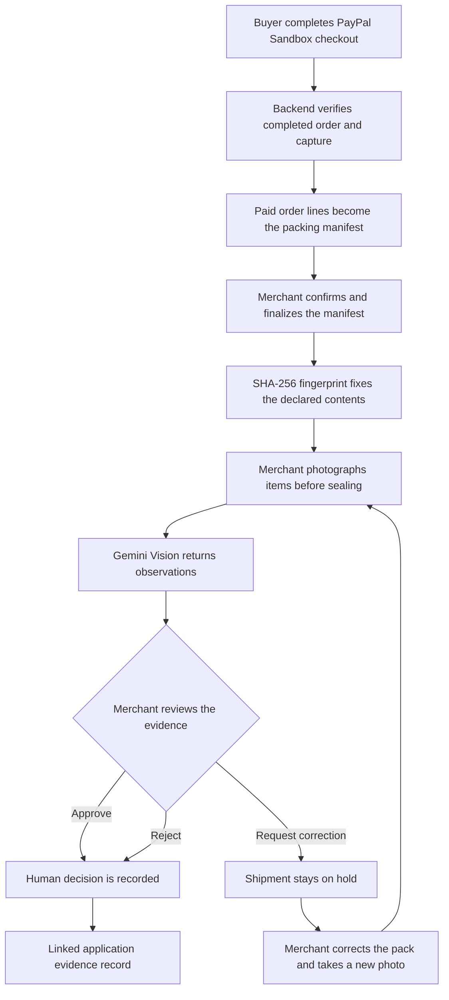

<div align="center">
  <h1>ParcelProof AI</h1>
  <p><strong>Check the pack against what the buyer paid for.</strong></p>
  <p>PayPal-linked, AI-assisted packing review for small online merchants—before the parcel is sealed.</p>
  <p>
    <a href="https://parcelproof-ai-058h.onrender.com"></a>
    <a href="https://github.com/BasutkarSony/ParcelProof-AI/actions/workflows/ci.yml"></a>
    <a href="LICENSE"></a>
  </p>
  <p>
    <a href="docs/DEMO-SCRIPT.md">Demo walkthrough</a> ·
    <a href="docs/MERCHANT-USER-MANUAL.md">Merchant guide</a> ·
    <a href="docs/DEVPOST-SUBMISSION.md">Submission notes</a>
  </p>
</div>

---

## What it does

A PayPal payment tells a merchant what the buyer ordered. It does not tell them whether the right product and quantity are actually on the packing table.

**ParcelProof connects those two moments.** It uses a verified PayPal Sandbox order to create the packing list, checks a pre-seal photograph against that list and saved product references with Google Gemini Vision, then records a separate decision by the merchant.

The first target user is an owner-operated online shop or a small team that packs physical orders manually. That customer profile is a product hypothesis; it has not yet been validated through formal customer interviews.

## The workflow



### What makes the flow different

- **The paid order is the source.** ParcelProof verifies the PayPal order and capture, including amount and currency, before using the purchased line items and quantities.
- **The manifest is fixed before inspection.** The merchant confirms the declared contents; finalization creates a SHA-256 fingerprint used by later inspection records.
- **AI observes; a person decides.** Gemini compares visible evidence with the manifest and private product identity details. Its output is advisory and never approves a shipment by itself.
- **Corrections remain traceable.** A correction request keeps the shipment on hold. The next photo is inspected against the same finalized manifest, while earlier inspection attempts and merchant decisions remain in history.

## The evidence record

ParcelProof links the following records to the shipment:

| Record | Purpose |
|---|---|
| PayPal order and capture references | Tie the workflow to the paid order |
| Finalized manifest and SHA-256 fingerprint | Preserve the merchant-declared contents |
| Packing photographs and SHA-256 digests | Identify the uploaded evidence files |
| AI inspection result and model details | Preserve what the vision model reported |
| Separate merchant decision and note | Record the human review outcome |

This is an application-level evidence trail. **It is not a blockchain, does not prove what is inside a sealed parcel, and does not independently prove dispatch or delivery.**

## Try the hosted demo

**[Open ParcelProof AI](https://parcelproof-ai-058h.onrender.com)**

The public demo uses synthetic records and PayPal Sandbox. Do not enter real customer, address or payment information.

| Access | Demo details |
|---|---|
| Username | `merchant.demo` |
| Password | `PackSafe#2026` |
| Starting point | Open **Orders** and choose an existing demonstration order |
| Fresh checkout | Requires a PayPal Sandbox buyer account; never use a live PayPal account |

The hosted service runs on Render's Free plan and may need to wake after inactivity. The demo uses one shared merchant login; it does not provide individual merchant accounts or tenant isolation.

## Technology

| Layer | Technology |
|---|---|
| Payments | PayPal Developer Platform — Orders v2 Sandbox |
| Vision inspection | Google Gemini API |
| Backend | Python 3.11+, FastAPI |
| Frontend | React, Vite |
| Hosted persistence | Supabase PostgreSQL and private Storage |
| Local persistence | SQLite by default; PostgreSQL can be configured |
| Deployment | Docker and Render |

PayPal is central to the product: the verified Sandbox capture supplies the order lines that become the packing manifest. Gemini then evaluates the photograph against that order-derived reference. Neither integration is a decorative add-on.

## Run locally

### Requirements

- Python 3.11 or later
- Node.js 22 or later
- Git

### 1. Get the code

```bash
git clone https://github.com/BasutkarSony/ParcelProof-AI.git
cd ParcelProof-AI
```

### 2. Configure and start the backend

```bash
cd backend
python -m venv .venv
```

Activate the environment, then install dependencies and create your local environment file:

```bash
# macOS / Linux
source .venv/bin/activate
cp .env.example .env

# Windows PowerShell
.venv\Scripts\Activate.ps1
Copy-Item .env.example .env
```

Add your own PayPal Sandbox REST app credentials and Google AI Studio Gemini API key to `.env`. Keep tracking submission disabled:

```dotenv
PAYPAL_CLIENT_ID=your_sandbox_client_id
PAYPAL_CLIENT_SECRET=your_sandbox_client_secret
GEMINI_API_KEY=your_gemini_api_key
PAYPAL_TRACKING_SUBMISSION_ENABLED=false
```

Install and run the API from the `backend` directory:

```bash
python -m pip install -r requirements.txt
uvicorn app.main:app --reload --host 127.0.0.1 --port 8000
```

Local development uses SQLite unless `DATABASE_URL` is configured. Supabase credentials are only needed when using the hosted Postgres and private Storage setup.

### 3. Start the frontend

In a second terminal, from the repository root:

```bash
cd frontend
npm ci
npm run dev
```

Open the local Vite URL shown in the terminal (normally `http://localhost:5173`).

### 4. Run the checks

Backend:

```bash
cd backend
python -m unittest discover -s tests -v
```

Frontend:

```bash
cd frontend
npm ci
npm test
npm run lint
npm run build
```

GitHub Actions also runs the backend unit suite, PostgreSQL persistence integration, frontend tests/lint/production build and Docker image build.

## Current scope and limitations

ParcelProof is a working hackathon prototype, not a production shipping or dispute platform.

- PayPal processing uses Sandbox, not live payments.
- Gemini can be wrong. Visual similarity does not guarantee an exact SKU or product variant.
- A photograph cannot verify the contents of a sealed parcel.
- The merchant makes the final approve, correction or reject decision.
- Carrier event feeds and independent dispatch/delivery verification are not implemented.
- PayPal tracking writes are disabled in the hosted demo.
- The prototype does not calculate Seller Protection eligibility or guarantee a dispute outcome.
- The hosted demo uses a shared login and synthetic data, not individual merchant accounts or tenant isolation.
- No measured reduction in packing errors, returns or support costs has been collected.

Use the demo and test data only. Do not rely on this prototype as the sole basis for a real-world shipping or dispute decision.

## Project docs

- [2:50 demo script](docs/DEMO-SCRIPT.md)
- [Merchant user guide](docs/MERCHANT-USER-MANUAL.md)
- [QA status and verified behavior](docs/QA-STATUS.md)
- [Release gate and remaining checks](docs/RELEASE-GATE.md)
- [Devpost submission notes](docs/DEVPOST-SUBMISSION.md)

## License

MIT. See [LICENSE](LICENSE).
